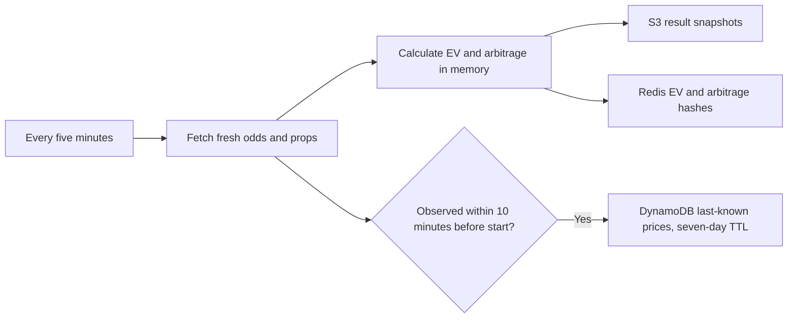

# Five-minute odds pipeline

One scheduled Lambda fetches NBA, NFL, NHL, MLB, and NCAAF every **five minutes**
from the in-house Odds API, including moneyline, spreads, and all supported
two-sided player props. The league list is in `odds_pipeline/leagues.py`.
The parser and result schema also support totals, but the current in-house API
does not expose game totals, so those result arrays remain empty.



All freshly fetched odds are processed, including events outside the archival
window. Raw odds are not written to S3. EV and arbitrage use the same collected
data; there are no independent hourly processing functions or S3/DynamoDB
snapshot readbacks in the processing path.

The client uses `X-API-Key` authentication and maps league keys to the in-house
`/v1/sports/{sport}/odds` and `/events` routes. Event discovery includes games
with props but no game-line quotes. Props use `/v1/events/{event_id}/odds` with
`markets=all_props&freshOnly=true`; stale cached prices are excluded. Each
over/under market retains its player, line, and period-specific market key.

## Last-known prices in DynamoDB

By default, SAM creates `${AWS::StackName}-ClosingOdds` with:

| Attribute | Meaning |
| --- | --- |
| `event_id` (partition key) | Actual Odds API event ID |
| `bet_key` (sort key) | Stable hash of event, market, player, line, book, and side |
| `odds` | Last observed decimal price for that exact bet/book |
| `league`, `category`, `market` | League and game-market/prop identity |
| `selection`, `side`, `player`, `line`, `book` | Quote identity and line |
| `commence_time` | Event's advertised start time |
| `observed_at` | UTC timestamp when this API response was received |
| `expires_at` | Numeric Unix timestamp: observation time plus seven days |

A quote is eligible only when `0 < commence_time - observed_at <= 600 seconds`.
Prices observed at or after the start, or more than ten minutes beforehand, are
not persisted. The filter uses each response's capture time: slow prop requests
cannot re-date earlier game-line quotes or slip post-start props into the archive.

Each eligible update overwrites the same event/bet/book row. Other books, players,
lines, and sides remain separate. Missing quotes keep their last-known price;
slower/older observations cannot overwrite newer ones. Prices are archived
regardless of whether the bet has positive EV or forms an arbitrage opportunity.

The table has DynamoDB TTL enabled on `expires_at`. Expiry is seven days after
the last captured price. AWS deletes expired items asynchronously; the event
lookup filters them immediately. See [AWS TTL behavior](https://docs.aws.amazon.com/amazondynamodb/latest/developerguide/TTL.html).

```python
from odds_pipeline.archive import ClosingOddsStore

prices = ClosingOddsStore().get_event("provider-event-id")
```

The lookup uses the event partition key and paginates; it does not scan the table.

## EV and arbitrage results

Every EV and arbitrage record contains **`event_id`**. EV `id` is a stable string
matching the corresponding closing-price row's `bet_key`, allowing a result to be
joined to its last-known price using `(event_id, id)`.

The existing fair-odds models and book weights are retained. Two-way markets are
compared only when their event, player, and complementary lines match. Arbitrage
is calculated directly from raw prices, independently of positive-EV eligibility.
Three-way draw markets are not treated as two-way bets.

For each league, the following S3 JSON arrays are replaced on every successful run:

| Output | Object key |
| --- | --- |
| EV moneyline | `ev/<LEAGUE>/moneyline_ev.json` |
| EV spreads / totals / props | `ev/<LEAGUE>/<CATEGORY>_ev.json` |
| Arbitrage moneyline | `arbitrage/<LEAGUE>/moneyline_arb.json` |
| Arbitrage spreads / totals / props | `arbitrage/<LEAGUE>/<CATEGORY>_arb.json` |

Redis uses two hashes, **`EV`** and **`arbitrage`**. Fields are
`<LEAGUE>/<CATEGORY>`, such as `NFL/props` and `NBA/moneyline`. Each value is JSON:

```json
{
  "schema_version": 1,
  "league": "NBA",
  "market": "moneyline",
  "retrieved_at": "2026-10-26T17:55:00+00:00",
  "updated_at": "2026-10-26T17:55:01+00:00",
  "count": 0,
  "opportunities": []
}
```

Successful empty results replace stale opportunities with empty arrays. Failed
leagues retain previous outputs while others proceed. If any prop event fails,
that league's previous complete prop outputs are preserved and game-market
outputs continue updating. S3, Redis, and closing-price failures are reported
independently; an outage of one store does not block the others.

## Deployment

Add the GitHub **repository secret `REDIS_URL`** containing the full TLS URL,
`rediss://default:<URL-encoded-password>@sharpedge-ruby-ruby.sage.cloud.layerbase.dev:6379`.
Keep the existing AWS credentials, `AWS_REGION`, and `ODDS_API_KEY` secrets.
`ODDS_API_KEY` must be a product key configured in the in-house API's `API_KEYS`.
Set the GitHub **repository variable `ODDS_API_BASE_URL`** to that API's reachable
HTTPS origin, without `/v1`. The local `lambda/.env` file is not read by Lambda.
The workflow builds, tests, and deploys changes pushed to `main`.

SAM supplies `CLOSING_ODDS_TABLE`, `RESULTS_BUCKET`, `REDIS_URL`, `ODDS_API_KEY`,
and `ODDS_API_BASE_URL` to the Lambda and creates its DynamoDB/S3 permissions. Redis credentials are
passed through a `NoEcho` parameter and are omitted from error logs. TLS verifies
the Redis certificate and hostname.

The scheduled function uses shared account concurrency by default. Reserving even
one execution can fail on accounts with a low regional Lambda concurrency quota,
because AWS requires a minimum pool of unreserved executions. After obtaining
enough quota, set the GitHub repository variable `ENABLE_RESERVED_CONCURRENCY` to
`true` (or pass `EnableReservedConcurrency=true` to SAM) to cap this function at
one concurrent execution. With the default setting, overlapping invocations are
possible. The function has a five-minute timeout, and asynchronous jobs expire
after five minutes with no retries for function errors.

### Recovering a rolled-back deployment

If deployment fails with `ReservedConcurrentExecutions` reducing unreserved
concurrency below its minimum, leave `ENABLE_RESERVED_CONCURRENCY` unset or set
it to `false`. A stack in `UPDATE_ROLLBACK_COMPLETE` can be updated again.

Check whether rollback retained the newly created closing-odds table. For the
`retrieve-odds-stack` deployment, its name is `retrieve-odds-stack-ClosingOdds`.
If the rollback events show `ClosingOddsTable DELETE_SKIPPED` and the table still
exists outside the stack, set the GitHub repository variable
`EXISTING_CLOSING_ODDS_TABLE_NAME` to `retrieve-odds-stack-ClosingOdds` before
pushing these changes to `main`. This reuses its data and grants the Lambda
access without trying to create a second table with the same name. The existing
table must have the `event_id`/`bet_key` key schema and TTL enabled on `expires_at`.
It remains managed outside CloudFormation; keep the variable set on subsequent
deployments. For manual SAM deployments, pass
`ExistingClosingOddsTableName=retrieve-odds-stack-ClosingOdds`.

Leave this variable unset for deployments that create a new table or already
manage `ClosingOddsTable` in the stack. Only set it to reuse a table outside the
stack; setting it for a managed table relinquishes CloudFormation ownership.

For `sam local invoke`, copy `env.example.json`, fill in its values, and pass
`--env-vars <private-file.json>`. Keep the filled-in file private. For a manual
deployment, pass `OddsApiKey`, `OddsApiBaseUrl`, and `RedisUrl` as SAM parameters.

The original `AllOdds` table is preserved during migration and no longer receives
writes. Existing raw S3 objects are not deleted; their caches stop refreshing.
Processed S3 results continue updating. The old hourly EV/arbitrage Lambda
resources are removed by deployment. The earlier experimental prop-history table
is no longer used; its existing retention policy preserves it if already deployed.
The frontend's old Current Markets view still reads the retired raw-moneyline S3
cache; its data source needs separate wiring. EV/arbitrage moneyline and props
object paths remain compatible.

## Verification

From this directory with Python 3.11+ and AWS SAM:

```sh
python -m pip install -r tests/requirements.txt -r requirements.txt
python -m pytest -q tests/unit
sam validate --lint --template-file template.yaml
sam build --template-file template.yaml
```

Tests emulate provider responses, DynamoDB, S3, and Redis without accessing a live
account. They cover time boundaries, TTL and last-price updates, event lookup,
all five leagues, event-ID propagation, line/player separation, and store/provider
failures. The built Lambda is also checked against Python 3.11.
