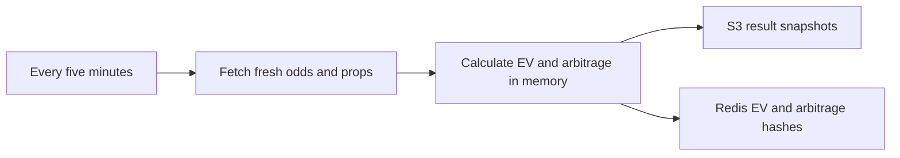

# Five-minute odds pipeline

One scheduled Lambda fetches NBA, NFL, NHL, NCAAF, and NCAAB every **five minutes**
from the in-house Odds API, including moneyline, spreads, and all supported
two-sided player props. The league list is in `odds_pipeline/leagues.py`.
MLB remains a supported sport mapping, but is excluded from
`ACTIVE_LEAGUE_SPORT_KEYS` during the offseason. The run does not request MLB
odds, events, or props. NCAAB uses `basketball_ncaab`, mapped to the in-house
`ncaab_basketball` routes. The website hides retained MLB opportunity snapshots.

The parser and result schema also support totals, but the current in-house API
does not expose game totals, so those result arrays remain empty.



All freshly fetched odds are processed in memory. Raw odds are not persisted.
EV and arbitrage use the same collected data; there are no independent hourly
processing functions or snapshot readbacks in the processing path.

The client uses `X-API-Key` authentication and maps league keys to the in-house
`/v1/sports/{sport}/odds` and `/events` routes. Event discovery includes games
with props but no game-line quotes. Props use `/v1/events/{event_id}/odds` with
`markets=all_props&freshOnly=true`; stale cached prices are excluded. Each
over/under market retains its player, line, and period-specific market key.

PrizePicks standard projections and Underdog props flow through the same event
requests as sportsbook props; Sportzino game lines and props are included too.
PrizePicks uses provider-supplied synthetic prices and does not contribute to
fair-price consensus. Fantasy entries are evaluated as targets but are excluded
from sportsbook arbitrage. Underdog names normalize to `Underdog` consistently.

## DynamoDB storage disabled

The pipeline does not create a DynamoDB client, read or write closing prices,
or depend on a table name. Old `CLOSING_ODDS_TABLE` settings are ignored. SAM
creates no DynamoDB tables and grants the function no DynamoDB permissions.
The legacy `EV_Bets` adapters also skip storage; `/storeBet` returns HTTP 410
with `stored: false`.

## EV and arbitrage results

Every EV and arbitrage record contains **`event_id`**. EV `id` remains a stable
identifier for the event, market, player, line, bookmaker, and selection.

The existing fair-odds models and book weights are retained. Two-way markets are
compared only when their event, player, and complementary lines match. Arbitrage
is calculated directly from raw prices, independently of positive-EV eligibility.
Three-way draw markets are not treated as two-way bets.

For each league, the following S3 JSON arrays are replaced on every successful run:

| Output | Object key |
| --- | --- |
| EV moneyline | `ev/<LEAGUE>/moneyline_ev.json` |
| EV spreads / totals / props | `ev/<LEAGUE>/<CATEGORY>_ev.json` |
| Arbitrage moneyline | `arbitrage/<LEAGUE>/moneyline_arb.json` |
| Arbitrage spreads / totals / props | `arbitrage/<LEAGUE>/<CATEGORY>_arb.json` |

Redis uses two hashes, **`EV`** and **`arbitrage`**. Fields are
`<LEAGUE>/<CATEGORY>`, such as `NFL/props` and `NBA/moneyline`. Each value is JSON:

```json
{
  "schema_version": 1,
  "league": "NBA",
  "market": "moneyline",
  "retrieved_at": "2026-10-26T17:55:00+00:00",
  "updated_at": "2026-10-26T17:55:01+00:00",
  "count": 0,
  "opportunities": []
}
```

Successful empty results replace stale opportunities with empty arrays. Failed
leagues retain previous outputs while others proceed. If any prop event fails,
that league's previous complete prop outputs are preserved and game-market
outputs continue updating. S3 and Redis failures are reported independently;
an outage of one store does not block the other.

## Deployment

Add the GitHub **repository secret `REDIS_URL`** containing the full TLS URL,
`rediss://default:<URL-encoded-password>@sharpedge-ruby-ruby.sage.cloud.layerbase.dev:6379`.
Keep the existing AWS credentials, `AWS_REGION`, and `ODDS_API_KEY` secrets.
`ODDS_API_KEY` must be a product key configured in the in-house API's `API_KEYS`.
Set the GitHub **repository variable `ODDS_API_BASE_URL`** to that API's reachable
HTTPS origin, without `/v1`. The local `lambda/.env` file is not read by Lambda.
The workflow builds, tests, and deploys changes pushed to `main`.

SAM supplies `RESULTS_BUCKET`, `REDIS_URL`, `ODDS_API_KEY`, and
`ODDS_API_BASE_URL` to the Lambda and creates its S3 write permissions. Redis credentials are
passed through a `NoEcho` parameter and are omitted from error logs. TLS verifies
the Redis certificate and hostname.

The scheduled function uses shared account concurrency by default. Reserving even
one execution can fail on accounts with a low regional Lambda concurrency quota,
because AWS requires a minimum pool of unreserved executions. After obtaining
enough quota, set the GitHub repository variable `ENABLE_RESERVED_CONCURRENCY` to
`true` (or pass `EnableReservedConcurrency=true` to SAM) to cap this function at
one concurrent execution. With the default setting, overlapping invocations are
possible. The function has a five-minute timeout, and asynchronous jobs expire
after five minutes with no retries for function errors.

### Recovering a rolled-back deployment

If deployment fails with `ReservedConcurrentExecutions` reducing unreserved
concurrency below its minimum, leave `ENABLE_RESERVED_CONCURRENCY` unset or set
it to `false`. A stack in `UPDATE_ROLLBACK_COMPLETE` can be updated again.

The workflow no longer discovers or reuses closing-odds tables. Remove the
obsolete `EXISTING_CLOSING_ODDS_TABLE_NAME` repository variable if present.
Deployment failure diagnostics still use `cloudformation:ListChangeSets` and
`cloudformation:DescribeEvents`, without dumping stack parameters.

For `sam local invoke`, copy `env.example.json`, fill in its values, and pass
`--env-vars <private-file.json>`. Keep the filled-in file private. For a manual
deployment, pass `OddsApiKey`, `OddsApiBaseUrl`, and `RedisUrl` as SAM parameters.

### Retained table cleanup

Deploying this change stops the scheduled closing-odds writes and removes the
function's DynamoDB permissions. Redeploy the legacy Flask/FastAPI service if
it is still running to disable its old EV bet writer as well.

Earlier templates set `DeletionPolicy: Retain`. Removing those resources from
SAM does not delete their stored data: `${AWS::StackName}-ClosingOdds` and
`${AWS::StackName}-AllOdds` can remain outside the stack. Any previously retained
experimental prop-history table and the legacy `EV_Bets` table are also outside
this deployment's cleanup. Retained data and backups can continue incurring
charges after writes stop. Review and delete the unused tables and backups in
the correct AWS account and region to finish eliminating those charges. This
deployment does not automatically delete historical data.

Processed S3 results continue updating. Existing raw S3 objects remain as before.
The frontend's old Current Markets view still reads the retired raw-moneyline S3
cache; its data source needs separate wiring. EV/arbitrage moneyline and props
object paths remain compatible.

## Verification

From this directory with Python 3.11+ and AWS SAM:

```sh
python -m pip install -r tests/requirements.txt -r requirements.txt
python -m pytest -q tests/unit
sam validate --lint --template-file template.yaml
sam build --template-file template.yaml
```

Tests emulate provider responses, S3, and Redis without accessing a live account.
All tests reject DynamoDB API calls. They cover all five leagues, event-ID
propagation, line/player separation, store/provider failures, the retired legacy
writers and endpoint, and stale table settings. Deployment checks ensure SAM
contains no DynamoDB resources, permissions, or environment settings.
